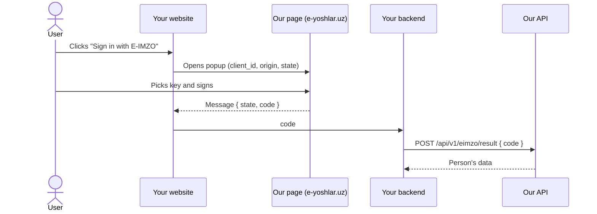

# Sign in with E-IMZO: guide for partners

Your users can prove who they are with their E-IMZO key (electronic digital signature). You get the person's
PINFL, full name and TIN, checked by us.

E-IMZO keys only work on the website they are registered for, and ours is `e-yoshlar.uz`. So the person signs
**on our page**, and your website gets back a **one-time code**. Your backend swaps that code for the person's
data. You don't need E-IMZO scripts or your own E-IMZO API key.

## How it works

1. The user clicks **"Sign in with E-IMZO"** on your website.
2. Your website opens our page `https://e-yoshlar.uz/eimzo-bridge` in a popup.
3. The user picks their E-IMZO key and signs. We check the signature.
4. Our page sends a one-time code back to your website and closes itself.
5. Your website gives the code to your backend.
6. Your backend sends the code to our API and gets the person's data.



The signature itself never leaves our side: your website only sees the code.

---

## 1. Getting access

### What you give us

| What | Example | Why we need it |
|---|---|---|
| System name | `Partner portal` | Shown to the user on our page: "Sign in to Partner portal" |
| Website address(es) | `https://partner.uz` | Our page sends the code only to these addresses |
| Server IP address(es) | `203.0.113.10` | Our API accepts requests only from these IPs |

Website addresses:

- Only `https://` + domain (+ port, if any): `https://partner.uz`. Not `https://partner.uz/login`, not
  `https://partner.uz/`.
- If your site opens on several addresses (with `www`, a test server), send all of them.
- We keep this list. To add or change an address later, contact us.

### What we give you

- **`client_id`**: your ID. It is not secret: you use it on your website and in your backend.
- **`client_secret`**: your password for our API. Keep it only on your server.
- **API address**: written as `{API}` below.

---

## 2. What your frontend does

### Step 1. Open our page

Call this directly in the button's click handler, otherwise the browser's popup blocker stops it.

```js
const CLIENT_ID = "your-client-id";
const state = crypto.randomUUID(); // new value for every sign-in

const params = new URLSearchParams({
  client_id: CLIENT_ID,
  origin: window.location.origin, // must match an address you gave us
  state,
});
const popup = window.open("https://e-yoshlar.uz/eimzo-bridge?" + params, "eimzo", "width=520,height=680");
```

### Step 2. Wait for our message

```js
window.addEventListener("message", (event) => {
  if (event.origin !== "https://e-yoshlar.uz") return; // trust only our page
  const data = event.data || {};
  if (data.state !== state) return; // not this sign-in

  if (data.type === "eimzo:result") sendCodeToYourBackend(data.code);
  if (data.type === "eimzo:error") showMessage("Signing was cancelled.");
});
```

| Message | When |
|---|---|
| `{ type: "eimzo:result", state, code }` | The signature is checked. Send `code` to your backend **right away**: it expires in 60 seconds |
| `{ type: "eimzo:error", state, error: "cancelled" }` | The user pressed "Cancel" |

If the key is invalid or the time runs out, our page shows the problem to the user and lets them try again.
You get no message for that.

### Good to know

- Use a popup (`window.open`). An iframe or a redirect won't work.
- Don't add `noopener` to `window.open`, and don't send the `Cross-Origin-Opener-Policy: same-origin` header on
  this page: both cut the link our page uses to send you the code. `same-origin-allow-popups` is fine.
- The user can simply close the popup. Check `popup.closed` from time to time to notice it.
- The user needs the E-IMZO program on their computer and their E-IMZO key.

---

## 3. What your backend does

### Step 1. Get a token

```http
POST {API}/api/v1/auth/token
Content-Type: application/json

{
  "grant_type": "client_credentials",
  "client_id": "your-client-id",
  "client_secret": "your-client-secret"
}
```

```json
{
  "access_token": "yia_at_…",
  "token_type": "Bearer",
  "expires_in": 3600,
  "scope": "eimzo.verify"
}
```

The token lasts 1 hour. Reuse it, and get a new one when it expires.

### Step 2. Swap the code for the person's data

```http
POST {API}/api/v1/eimzo/result
Authorization: Bearer <access_token>
Content-Type: application/json

{ "code": "q8ZtR0b1Yc3X…" }
```

```json
{
  "success": true,
  "request_id": "5d1c9a0e-1f4b-4e8f-9a36-0f3e3b7c2a11",
  "data": {
    "pinfl": "31234567890123",
    "full_name": "VALIYEV ALI KARIMOVICH",
    "individual_tin": "512345678",
    "legal_entity_tin": "301234567",
    "organisation_name": "\"NAMUNA\" MCHJ",
    "position": "Direktor",
    "serial_number": "7a1b2c3d",
    "valid_from": "2026.01.10 10:00:00",
    "valid_to": "2028.01.10 23:59:59"
  }
}
```

| Field | Meaning |
|---|---|
| `pinfl` | The person's PINFL |
| `full_name` | Full name, as written in the certificate |
| `individual_tin` | The person's TIN |
| `legal_entity_tin` | The organisation's TIN, only if the key was issued for an organisation |
| `organisation_name`, `position` | Organisation and job title, if the certificate has them |
| `serial_number` | Certificate serial number |
| `valid_from`, `valid_to` | Certificate validity period |

A field the certificate doesn't have comes back as `null`.

### Step 3. Sign the user in

What happens next is up to you: for example, find the user by `pinfl` and open a session.

### Good to know

- Keep `client_secret` and tokens on your server. Never put them in the website.
- A code works **once**, for **60 seconds**, and only with your `client_id`.
- Call our API only from the server IPs you gave us.
- Your `client_secret` is valid for 90 days. When we give you a new one, the old one keeps working for up to
  7 days, so you can switch without downtime.

### Errors

```json
{
  "success": false,
  "request_id": "5d1c9a0e-1f4b-4e8f-9a36-0f3e3b7c2a11",
  "error": { "code": "invalid_code", "message": "…" }
}
```

Check `error.code` in your code; `error.message` is only for people.

| HTTP | `error.code` | What it means | What to do |
|---|---|---|---|
| 400 | `invalid_code` | The code is wrong, older than 60 seconds, already used, or belongs to another client | Ask the user to sign again |
| 400 | `invalid_request` | `code` is missing, empty or too long | Fix the request |
| 401 | `invalid_token` | The token is wrong or expired | Get a new token |
| 403 | `ip_not_allowed` | The request came from an IP we don't know | Call from your registered server, or send us the new IP |
| 403 | `insufficient_scope` | E-IMZO access isn't turned on for your client | Contact us |
| 429 | `rate_limited` | Too many requests | Wait the number of seconds in the `Retry-After` header |

The token endpoint answers errors in a slightly different shape: `{"error": "invalid_client", "error_description": "…"}`.
A wrong `client_id` or `client_secret` gives 401 `invalid_client`. After 5 wrong attempts in a row, the client is
blocked for 15 minutes (429).

---

## 4. Testing

- Ask us to add your local address, for example `http://localhost:3000`, to your website addresses. Then you can
  test from your computer with our live page.
- Your test backend also calls our API, so its IP must be on your list too.
- To sign, you need a real E-IMZO key and the E-IMZO program.

## Need help?

Every API response has an `X-Request-ID` header. If something goes wrong, send us that value with your question.
